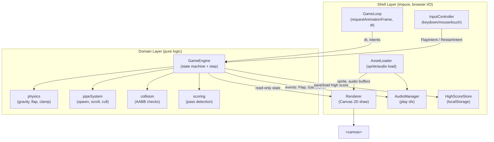
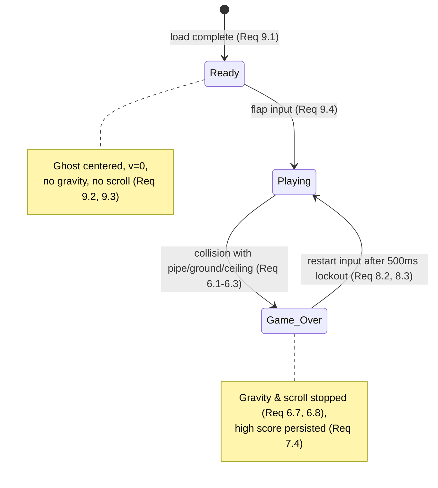

# Design Document

## Overview

Flappy Kiro is a client-side, browser-based endless scroller rendered on a single HTML5 Canvas. The player controls a ghost that is pulled down by constant gravity and pushed up by discrete flap impulses (spacebar, click, or tap). Green pipe pairs scroll from right to left; the player scores by passing through the gaps and loses on collision with a pipe, the ground, or the ceiling. The high score persists across sessions via `localStorage`.

The design separates **pure game logic** (physics, spawning, collision, scoring, state transitions) from **impure I/O concerns** (canvas rendering, audio playback, DOM input, storage, the animation loop). This separation is deliberate: the pure logic layer is deterministic and directly amenable to property-based testing, while the I/O layer is thin, mostly declarative, and validated with example/integration tests.

### Design Goals and Rationale

- **Frame-rate independence** (Req 4.1, 10.3): physics and scrolling advance by elapsed real time (delta seconds), not per-frame constants, so behavior is consistent from 30 to 144+ fps. A single `dt` value drives velocity integration and pipe movement.
- **Deterministic core** (Req 2.1): gravity integration is a pure function of state and `dt`. Randomness (gap placement) is isolated behind an injectable RNG so tests can seed it.
- **Graceful degradation** (Req 1.5, 3.6, 6.6, 7.6, 10.4): every external dependency — sprite load, audio playback, `localStorage`, canvas support — has a defined fallback that keeps the game running (or fails cleanly for unsupported canvas).
- **Single source of truth**: one `GameState` object holds all mutable world state; rendering is a pure read of that state.

### Technology Choices

- **Rendering**: HTML5 Canvas 2D context (Req 10.1). No WebGL; the scene is simple 2D shapes plus one sprite.
- **Language**: Vanilla JavaScript (ES modules), no framework (Req 10.2). Keeps the game fully client-side with zero build-time server dependency.
- **Persistence**: `localStorage` for the high score (Req 7).
- **Testing**: [Vitest](https://vitest.dev/) as the runner plus [fast-check](https://github.com/dubzzz/fast-check) for property-based testing. fast-check is the de-facto PBT library for JS/TS and integrates cleanly with Vitest. The pure logic modules are imported directly and tested in Node (no DOM needed).

## Architecture

The application is organized into a pure **domain layer** and an impure **shell layer**. The shell owns the browser (canvas, audio, input, storage, RAF loop) and delegates all decisions to the domain layer.



### Game Loop and Timing

The loop uses `requestAnimationFrame`. Each tick computes `dt` (seconds since last frame) and calls `engine.step(dt, intents)` followed by `renderer.draw(engine.state)`.

- `dt` is clamped to a maximum (e.g. 0.05 s ≈ 20 fps floor) so that a long stall or a resumed hidden tab cannot teleport the ghost through pipes.
- When the tab is hidden/blurred, the loop pauses (Req 10.5): `requestAnimationFrame` naturally throttles when hidden, and we additionally stop stepping on `visibilitychange`/`blur` and resume on `focus`/`visible`, resetting the timestamp so no giant `dt` accumulates.

```mermaid
sequenceDiagram
    participant RAF as requestAnimationFrame
    participant Loop as GameLoop
    participant Eng as GameEngine
    participant Rnd as Renderer
    RAF->>Loop: timestamp
    Loop->>Loop: dt = clamp(timestamp - last)
    Loop->>Eng: step(dt, drainIntents())
    Eng-->>Loop: emitted events (flap, gameOver)
    Loop->>Rnd: draw(engine.state)
    Loop->>RAF: schedule next frame (if running)
```

### State Machine

`Game_State` is one of `Ready`, `Playing`, `Game_Over` (Req: Glossary, Req 9, 6, 8).



Transitions and their side effects are all decided inside `GameEngine.step`. The engine returns a list of **events** (`FlapApplied`, `GameOver`, `Scored`) that the shell maps to audio/storage effects, keeping the domain free of I/O.

## Components and Interfaces

### Domain Layer

#### GameEngine

The orchestrator. Holds the single `GameState` and advances it one step per tick.

```
interface StepInput {
  dt: number;                 // clamped elapsed seconds
  intents: Intent[];          // Flap | Restart, drained from input this tick
  now: number;                // monotonic ms timestamp (for the 500ms restart lockout)
}

interface StepResult {
  events: GameEvent[];        // FlapApplied | Scored | GameOver
}

class GameEngine {
  state: GameState;
  constructor(config: GameConfig, rng: () => number, initialHighScore: number);
  step(input: StepInput): StepResult;   // pure w.r.t. state + injected rng
  reset(): void;                        // -> Ready
}
```

Behavior by state:
- **Ready**: ghost held centered with zero velocity; no gravity, no scroll (Req 9.2, 9.3). A Flap intent transitions to Playing and applies one upward impulse (Req 9.4).
- **Playing**: apply gravity then integrate position (Req 2.2); apply at most one flap per intent (Req 3.1–3.4); scroll/spawn/cull pipes (Req 4); detect passes and score (Req 5); detect collisions and possibly transition to Game_Over (Req 6).
- **Game_Over**: no gravity, no scroll (Req 6.7, 6.8). A Restart intent that arrives ≥ 500 ms after entering Game_Over resets the world and transitions to Playing (Req 8.2, 8.3); earlier inputs are ignored.

#### physics

Pure functions over the ghost and config.

```
applyGravity(ghost, gravity, maxFall, dt) -> ghost'   // v += g*dt, clamp to maxFall, then y += v*dt (Req 2.1,2.2,2.4)
applyFlap(ghost, flapVelocity) -> ghost'              // v = -flapVelocity (Req 3.1)
```

Ordering is fixed: velocity is updated by gravity before position is updated by velocity (Req 2.2). Downward velocity is clamped to `maxFallVelocity` (Req 2.4).

#### pipeSystem

Manages the pipe collection: scrolling, culling, and spawning.

```
scroll(pipes, scrollSpeed, dt) -> pipes'              // x -= speed*dt for each (Req 4.1)
cull(pipes, canvasWidth) -> pipes'                    // drop pipes fully past left edge (Req 4.2)
maybeSpawn(pipes, config, rng, canvasWidth) -> pipes' // add new pipe when spacing threshold met (Req 4.3)
makePipePair(config, rng, spawnX) -> PipePair         // randomized gapY & gapHeight (Req 4.4, 4.5)
```

Gap placement (Req 4.4, 4.5):
- `gapHeight = uniform(2.5, 4) * ghostHeight`.
- `gapY` (gap top) uniformly chosen so the whole gap plus a ≥ 20 px margin stays inside the Play_Area: `gapY ∈ [ceiling + 20, groundTop − 20 − gapHeight]`.

Spawn spacing uses horizontal distance between the last spawned pipe and the right edge; a new pipe enters when that distance falls into the 200–400 px window, guaranteeing at least one pair is present or approaching (Req 4.3).

#### collision

Pure AABB (axis-aligned bounding box) overlap tests.

```
hitsPipe(ghostBox, pipePair) -> boolean               // overlap >= 1px with either pipe (Req 6.1)
hitsGround(ghostBox, groundTop) -> boolean            // ghost.bottom >= groundTop (Req 6.2)
hitsCeiling(ghostBox, ceilingY) -> boolean            // ghost.top <= ceilingY (Req 6.3)
```

#### scoring

Detects gap passes and updates score, guarding against double-counting.

```
detectPasses(ghost, pipes) -> { pipes', scoreDelta }  // mark a pipe scored when ghost.x passes its trailing edge (Req 5.1, 5.2, 5.4)
clampScore(score) -> [0, 999999]                      // (Req 5.5)
```

Each `PipePair` carries a `scored: boolean` flag. A pair is counted at most once (Req 5.2), only if not collided (Req 5.4), and the score is clamped to `[0, 999999]` (Req 5.5).

### Shell Layer

#### GameLoop
Owns `requestAnimationFrame`, computes and clamps `dt`, drains queued intents from `InputController`, calls `engine.step`, then `renderer.draw`. Handles pause/resume on visibility/focus changes (Req 10.5).

#### InputController
Registers `keydown`/`keyup` (spacebar), `mousedown`, and `touchstart` listeners on the canvas. Translates them into `FlapIntent`/`RestartIntent` queued for the next tick. Tracks spacebar key state so a held key produces exactly one flap per physical press (Req 3.2) — a flap is queued on `keydown` only when the key was previously up.

#### Renderer
Pure read of `GameState` → canvas draw calls (Req 1): sky fill, cloud shapes, ground strip, pipes, ghost sprite (or placeholder rectangle if the sprite failed to load, Req 1.5), and the score/high-score text `"Score: {score} | High: {high}"` bottom-center while Playing (Req 1.7), plus the Game_Over restart prompt (Req 8.1) and Ready prompt.

#### AudioManager
Wraps the two sound effects. `playFlap()` and `playGameOver()` restart the clip from the beginning (Req 3.5). Each call is wrapped so a rejected `play()` promise or load failure is swallowed and gameplay continues (Req 3.6, 6.6). Game-over plays exactly once per transition (Req 6.5) because it is driven by a single `GameOver` event.

#### HighScoreStore
`load()` reads and validates the stored value (Req 7.1–7.3); `save(score)` writes it (Req 7.4). Both are wrapped in try/catch so storage exceptions (private mode, quota) never crash the game (Req 7.6); a failed save sets a transient flag the Renderer surfaces to the player.

#### AssetLoader
Loads `assets/ghosty.png`, `assets/jump.wav`, `assets/game_over.wav`. Records per-asset success/failure so the Renderer and AudioManager can fall back (Req 1.5, 3.6, 6.6). Never blocks startup on failure.

#### Bootstrap / Canvas support
On load, detects canvas support (`canvas.getContext` exists and returns a 2D context). If unsupported, renders an "unsupported browser" message and does not start the loop (Req 10.4). Otherwise initializes the engine in `Ready` (Req 9.1).

## Data Models

```
type GamePhase = "Ready" | "Playing" | "Game_Over";

interface Ghost {
  x: number;          // fixed horizontal position
  y: number;          // vertical center (or top-left, consistent throughout)
  vy: number;         // vertical velocity (px/s), + is downward
  width: number;
  height: number;
}

interface PipePair {
  x: number;          // left edge, moves right -> left
  width: number;
  gapY: number;       // top of the gap
  gapHeight: number;
  scored: boolean;    // guards double counting (Req 5.2)
}

interface GameState {
  phase: GamePhase;
  ghost: Ghost;
  pipes: PipePair[];
  score: number;          // integer, clamped [0, 999999] (Req 5.5)
  highScore: number;      // integer
  gameOverAt: number | null;  // timestamp for 500ms restart lockout (Req 8.3)
  saveFailed: boolean;        // surfaced to player (Req 7.6)
  spriteLoaded: boolean;      // placeholder fallback flag (Req 1.5)
}

interface GameConfig {
  canvasWidth: number;
  canvasHeight: number;
  ceilingY: number;           // top of Play_Area
  groundTop: number;          // top of ground strip = bottom of Play_Area
  gravity: number;            // px/s^2 (Req 2.1)
  maxFallVelocity: number;    // px/s (Req 2.4)
  flapVelocity: number;       // px/s upward magnitude (Req 3.1)
  scrollSpeed: number;        // px/s, 100..300 (Req 4.1)
  pipeSpacingMin: number;     // 200 (Req 4.3)
  pipeSpacingMax: number;     // 400 (Req 4.3)
  gapMargin: number;          // >= 20 (Req 4.4)
  gapHeightMin: number;       // 2.5 * ghostHeight (Req 4.5)
  gapHeightMax: number;       // 4 * ghostHeight (Req 4.5)
  pipeWidth: number;
  restartLockoutMs: number;   // 500 (Req 8.3)
}
```

Derived helper: `ghostBox(ghost)` produces the AABB `{ left, right, top, bottom }` used by collision and scoring.

The Play_Area is bounded by `ceilingY` (top) and `groundTop` (bottom); the ground strip occupies `groundTop..canvasHeight`.

## Correctness Properties

*A property is a characteristic or behavior that should hold true across all valid executions of a system — essentially, a formal statement about what the system should do. Properties serve as the bridge between human-readable specifications and machine-verifiable correctness guarantees.*

The following properties were derived from the acceptance criteria testing prework. Redundant criteria were consolidated (e.g. the three flap-input sources into one impulse property, the two gap-geometry constraints into one gap-validity property, the two Game_Over freeze rules into one, and the score-vs-high pair into a single `max` property).

### Property 1: Gravity integration order and effect

*For any* ghost state and any elapsed time `dt ≥ 0`, one Playing-phase physics step SHALL first update vertical velocity by `gravity * dt` (then clamp), and SHALL then update vertical position using the resulting post-gravity velocity, so that `y' = y + clamp(vy + gravity*dt) * dt`.

**Validates: Requirements 2.1, 2.2**

### Property 2: Maximum fall velocity is never exceeded

*For any* ghost state and any sequence of Playing-phase gravity steps with arbitrary `dt` values, the ghost's downward vertical velocity SHALL never exceed `maxFallVelocity`.

**Validates: Requirements 2.4**

### Property 3: Flap applies a fixed upward impulse regardless of source

*For any* ghost state and *for any* flap input source (spacebar, mouse click, or touch tap), applying the flap SHALL set the ghost's vertical velocity to exactly `-flapVelocity`, identical across all three sources.

**Validates: Requirements 3.1, 3.3, 3.4**

### Property 4: One flap per discrete key press

*For any* sequence of spacebar `keydown`/`keyup` events, the number of flaps produced SHALL equal the number of up-to-down transitions in that sequence (a held key produces no additional flaps).

**Validates: Requirements 3.2**

### Property 5: Pipes scroll frame-rate independently

*For any* pipe set and *for any* partition of a total elapsed time into sub-intervals, scrolling by each sub-interval in sequence SHALL leave every pipe at the same horizontal position as scrolling once by the total elapsed time, moving left at `scrollSpeed` px/s.

**Validates: Requirements 4.1**

### Property 6: Off-screen pipes are culled

*For any* pipe set, after culling, the result SHALL retain exactly those pipes whose rightmost edge has not crossed the left edge of the canvas by 1 or more pixels, and remove all others.

**Validates: Requirements 4.2**

### Property 7: Spawn spacing stays within bounds and maintains coverage

*For any* run of the spawning system over a scrolling sequence, the horizontal spacing between consecutive spawned Pipe_Pairs SHALL remain within `[200, 400]` pixels, ensuring at least one Pipe_Pair is always present or approaching within the Play_Area.

**Validates: Requirements 4.3**

### Property 8: Generated gaps are valid and passable

*For any* Pipe_Pair produced by the generator with any RNG draw, the gap height SHALL lie within `[2.5 * ghostHeight, 4 * ghostHeight]`, and the entire gap plus a margin of at least 20 pixels SHALL lie within the Play_Area boundaries (`gapY ≥ ceilingY + 20` and `gapY + gapHeight ≤ groundTop − 20`).

**Validates: Requirements 4.4, 4.5**

### Property 9: Scoring counts each passed, uncollided pipe exactly once

*For any* Playing scenario, the score SHALL increase by exactly 1 when the ghost passes the trailing edge of a Pipe_Pair it has not collided with, and SHALL NOT increase for a Pipe_Pair that was collided with before its trailing edge was passed.

**Validates: Requirements 5.1, 5.4**

### Property 10: Pass detection is idempotent

*For any* game state, applying pass detection a second time without any movement SHALL produce a score delta of zero, so an already-counted Pipe_Pair is never counted again.

**Validates: Requirements 5.2**

### Property 11: Score stays an integer within range

*For any* sequence of scoring updates, the score SHALL remain an integer within `[0, 999999]` inclusive.

**Validates: Requirements 5.5**

### Property 12: Pipe collision matches AABB overlap

*For any* ghost bounding box and any Pipe_Pair, the pipe-collision predicate SHALL report a hit if and only if the ghost box overlaps either pipe's bounding box by 1 or more pixels.

**Validates: Requirements 6.1**

### Property 13: Any collision transitions to Game_Over

*For any* Playing state in which the ghost collides with a pipe, has its bottom at or below the ground top, or has its top at or above the ceiling, one step SHALL transition the Game_State to Game_Over.

**Validates: Requirements 6.1, 6.2, 6.3**

### Property 14: Game_Over freezes the world

*For any* Game_Over state and any number of subsequent steps, the ghost's position and velocity SHALL remain unchanged (no gravity) and every Pipe_Pair's position SHALL remain unchanged (no scroll).

**Validates: Requirements 6.7, 6.8**

### Property 15: High score parsing is total and range-bounded

*For any* value read from Local_Storage (including missing, non-numeric, negative, or out-of-range values), parsing SHALL return an integer within `[0, 999999999]` inclusive without throwing, returning 0 for any value that cannot be parsed as an integer in that range.

**Validates: Requirements 7.3**

### Property 16: High score becomes the maximum and persists only when beaten

*For any* final `score` and existing `highScore` at a Game_Over transition, the resulting high score SHALL equal `max(score, highScore)`, and a write to Local_Storage SHALL occur if and only if `score > highScore`.

**Validates: Requirements 7.4, 7.5**

### Property 17: Restart produces a canonical fresh Playing state

*For any* Game_Over state where the restart input arrives at least 500 ms after entering Game_Over, applying the restart SHALL reset the ghost to the Ready start position and vertical velocity, clear all Pipe_Pairs, set the score to 0, and transition the Game_State to Playing.

**Validates: Requirements 8.2**

### Property 18: Restart is locked out for 500 ms

*For any* restart input that arrives less than 500 ms after the transition into Game_Over, the Game_State SHALL remain Game_Over and the input SHALL be ignored.

**Validates: Requirements 8.3**

### Property 19: Ready is a stable, centered state

*For any* configuration, while the Game_State is Ready the ghost SHALL be horizontally and vertically centered within the Play_Area with zero vertical velocity, and *for any* number of steps taken while Ready, the ghost and all Pipe_Pairs SHALL remain unchanged (no gravity, no scroll).

**Validates: Requirements 9.2, 9.3**

### Property 20: Flap from Ready starts play with an upward impulse

*For any* Ready state, a flap input SHALL transition the Game_State to Playing and set the ghost's vertical velocity to `-flapVelocity`.

**Validates: Requirements 9.4**

### Property 21: Score/high-score formatting

*For any* non-negative integers `score` and `high`, the score display string SHALL equal exactly `"Score: {score} | High: {high}"`.

**Validates: Requirements 1.7**

## Error Handling

The game is designed to degrade gracefully rather than crash. Each external dependency has an explicit fallback path.

| Failure | Detection | Handling | Requirement |
|---|---|---|---|
| Ghost sprite fails to load | `img.onerror` sets `spriteLoaded = false` | Renderer draws a solid-color placeholder rectangle at the ghost position; scene keeps rendering | 1.5 |
| Flap sound fails / blocked | `audio.play()` promise rejects or asset missing | `AudioManager.playFlap` swallows the error; flap impulse is applied regardless | 3.6 |
| Game-over sound fails | `audio.play()` promise rejects or asset missing | `AudioManager.playGameOver` swallows the error; state still transitions to Game_Over | 6.6 |
| High score unreadable / invalid | `parseHighScore` validation (Property 15) | Falls back to `highScore = 0`; game continues | 7.2, 7.3 |
| High score save fails | `try/catch` around `localStorage.setItem` | In-session `highScore` retained; `saveFailed = true` surfaced to player; game continues | 7.6 |
| Canvas unsupported | `getContext("2d")` missing or returns null | Render an "unsupported browser" message; do not start the loop | 10.4 |
| Tab hidden / blurred | `visibilitychange` / `blur` events | Pause the loop; retain state; reset timestamp on resume so no large `dt` accumulates | 10.5 |
| Very large `dt` (stall/resume) | `dt` clamped to a max in the loop | Prevents tunneling through pipes and physics blow-up | 4.1, 6 (integrity) |

All audio and storage operations are wrapped so that no external failure can propagate an exception into the game loop. The domain layer never performs I/O, so it cannot throw on external failure; the shell isolates every I/O call.

## Testing Strategy

Property-based testing **is appropriate** for this feature: the domain layer (physics, pipe system, collision, scoring, state transitions, high-score parsing, formatting) is pure and deterministic with clear input/output behavior and universal invariants over a large input space. The shell layer (rendering, audio, DOM input, storage, the RAF loop) is I/O and is covered by example/integration tests instead.

### Tooling

- **Runner**: [Vitest](https://vitest.dev/).
- **Property-based testing**: [fast-check](https://github.com/dubzzz/fast-check). We use an existing, well-maintained library rather than implementing PBT from scratch.
- Domain modules are imported directly and tested in Node without a DOM. Shell modules are tested with mocks/stubs (mocked `HTMLAudioElement`, `localStorage`, canvas context) and jsdom where a DOM is needed.

### Property Tests (domain layer)

- Each correctness Property above is implemented by a **single** fast-check property test.
- Each property test runs a **minimum of 100 iterations** (`{ numRuns: 100 }` or greater).
- Each test is tagged with a comment referencing the design property, in the format:
  `// Feature: flappy-kiro, Property {number}: {property_text}`
- Generators:
  - Ghost/velocity/dt: bounded floats within realistic ranges (dt in `[0, clampMax]`).
  - Pipe sets: arrays of pipes with arbitrary x, gap geometry.
  - RNG: seeded deterministic generator injected into the pipe generator so gap-validity (Property 8) is reproducible.
  - Arbitrary strings and mixed values for high-score parsing (Property 15).
  - Integer pairs for the `max` high-score property (Property 16) and for formatting (Property 21).
  - Event sequences (keydown/keyup) for the debounce property (Property 4).
  - Time deltas for the restart lockout (Property 18).

### Unit / Example Tests

Focused example tests cover deterministic branches and specific scenarios that are not universal:
- Sprite placeholder fallback path (Req 1.5) and cloud/ground/pipe/ghost draw calls (Req 1.2–1.4, 1.6).
- Flap and game-over audio calls, including the failure-tolerant paths (Req 3.5, 3.6, 6.5, 6.6) via mocked audio.
- High-score load timing and empty-storage default (Req 7.1, 7.2) and save-failure indication (Req 7.6) via mocked storage.
- Canvas feature-detection message and no-start behavior (Req 10.4).
- Game_Over restart prompt and final-score display (Req 8.1).
- Collision evaluated once per step (Req 6.4).
- Initialization to Ready on load (Req 9.1).

### Integration / Smoke Tests

- Single-canvas rendering and client-side-only execution (Req 10.1, 10.2) verified structurally.
- Loop maintains ≥ 30 fps (Req 10.3) — measured/manual, since it depends on the browser runtime.
- Tab visibility pause and state retention (Req 10.5) via simulated `visibilitychange` events asserting stepping stops and state is preserved.

### Coverage Mapping Summary

Property tests cover Requirements 1.7, 2.x, 3.1–3.4, 4.x, 5.x, 6.1–6.3/6.7/6.8, 7.3–7.5, 8.2, 8.3, 9.2–9.4. Example/integration tests cover the remaining rendering, audio, storage-I/O, loop, and feature-detection criteria (1.1–1.6, 3.5/3.6, 6.4–6.6, 7.1/7.2/7.6, 8.1, 9.1, 10.1–10.5). Together they give comprehensive coverage: property tests verify general correctness across the input space, and example/integration tests pin down concrete behaviors and I/O edge cases.
